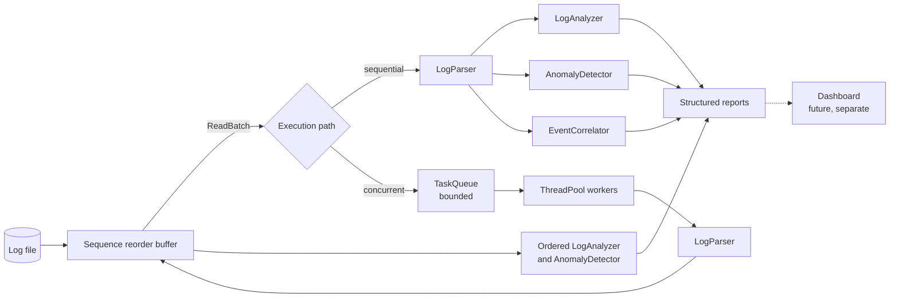

# SentinelX

**A C++20 engine for concurrent log processing, statistical anomaly detection, and event correlation.**

SentinelX reads large system logs incrementally, parses them into structured
events, aggregates statistics, flags unusual ERROR activity, and links related
events into explainable reports. The engine is a standalone C++ library; any
dashboard is a separate consumer of its output.

> **Project status:** the core library, a `sentinelx` command-line analyzer, its
> tests, an optional benchmark suite, and dataset tooling exist. There is no
> dashboard yet. See [Future Improvements](#future-improvements).

---

## Table of Contents

1. [Project Overview](#project-overview)
2. [Problem Statement](#problem-statement)
3. [Features](#features)
4. [Technology Stack](#technology-stack)
5. [System Architecture](#system-architecture)
6. [Module Descriptions](#module-descriptions)
7. [Folder Structure](#folder-structure)
8. [Installation](#installation)
9. [Building with CMake](#building-with-cmake)
10. [Running SentinelX](#running-sentinelx)
11. [Testing](#testing)
12. [Benchmarks](#benchmarks)
13. [Dashboard](#dashboard)
14. [Design Decisions and Trade-offs](#design-decisions-and-trade-offs)
15. [Future Improvements](#future-improvements)
16. [License](#license)

---

## Project Overview

SentinelX contains reusable processing modules plus an end-to-end pipeline
that can be used sequentially or concurrently:

```text
FileReader -> LogParser -> LogAnalyzer / AnomalyDetector / EventCorrelator
                 ^
  TaskQueue + ThreadPool (concurrent path)
```

FileReader uses bounded batches and does not retain the whole file. Total
pipeline memory also includes accumulated analyzer cardinality, anomaly reports,
and the configured cap on retained correlation events; it is not bounded by
batch size alone. Sequential and concurrent paths share parsing and analysis
logic.

## Problem Statement

Production systems generate large volumes of logs. Diagnosing problems from them
usually means one of three things:

- loading entire files into memory, which does not scale to multi-gigabyte logs;
- searching manually, which misses gradual or component-specific error spikes;
- reading messages in isolation, without context such as the warnings that came
  before a failure.

SentinelX addresses these gaps with streaming ingestion, structured parsing,
per-component statistics, transparent statistical detection, and timeline
correlation. Every report explains how it was produced and does not claim
causation.

## Features

| Area | Capability |
| --- | --- |
| Ingestion | Incremental, buffered reading in configurable batches; bounded line length; reports missing, unreadable, and empty files |
| Parsing | Strict `YYYY-MM-DD HH:MM:SS LEVEL COMPONENT: MESSAGE` grammar; calendar-validated timestamps; typed parse errors; malformed input never throws |
| Analysis | Record totals; INFO, WARNING, ERROR, and DEBUG counts and percentages; errors per component; most frequent and repeated error messages |
| Concurrency | Reusable thread pool that returns futures; bounded producer-consumer queue with backpressure; shutdown drains pending work, then joins all threads |
| Anomaly detection | Per-component rolling time windows; mean plus standard deviation thresholds; configurable severity bands; explainable reports; no alerts until enough history exists |
| Correlation | Chronological component timelines; warnings before errors; repeated error messages and sequences; ranked, explained reports; handles missing and out-of-order timestamps |
| Quality | GoogleTest suite; AddressSanitizer and ThreadSanitizer CMake options |
| Performance | `sentinelx_bench` measures the real pipeline and writes CSV/Markdown; a separate optional Google Benchmark target and Python JSON runner are retained |
| Tooling | Python generator for synthetic datasets of 10K, 100K, 1M, and 5M records |

## Technology Stack

| Concern | Technology |
| --- | --- |
| Language | C++20 (`std::span`, `std::chrono` calendar types, designated initializers, `std::from_chars`) |
| Concurrency | `std::thread`, `std::mutex`, `std::condition_variable`, `std::atomic`, `std::packaged_task` |
| Build | CMake 3.20+ with `FetchContent` |
| Testing | GoogleTest 1.15.2 (fetched at a pinned commit) and two standalone test programs |
| Benchmarking | Custom C++ pipeline harness; optional legacy Google Benchmark 1.9.4 target |
| Memory and race checking | AddressSanitizer (MSVC, GCC, Clang); ThreadSanitizer (GCC, Clang) |
| Scripting | Python 3, standard library only |
| Verified toolchain | Visual Studio 2022, MSVC 19.44, Windows SDK 10.0.26100, x64 |

## System Architecture



Modules exchange only value types (`ReadBatch`, `BatchParseResult`, `LogEntry`,
and the report structs). There is no global state, and the core library has no
UI dependency. See [docs/ARCHITECTURE.md](docs/ARCHITECTURE.md) for data flow,
thread-safety rules, and the shutdown sequence.

## Module Descriptions

| Module | Responsibility | Key API |
| --- | --- | --- |
| **FileReader** | Streams a file in batches through an explicit stream buffer. Skips and counts lines that are too long or contain NUL bytes. | `FileReader(path, FileReaderOptions)`, `read_next_batch()` |
| **LogParser** | Validates lines and parses them into `LogEntry`. Rejects malformed lines with a typed `ParseError` and the line's index in the batch. | `parse_line()`, `parse_batch()` |
| **LogAnalyzer** | Accumulates record and severity counts, errors per component, and rankings of error messages by frequency. | `consume()`, `summary()`, `reset()` |
| **ThreadPool** | Runs tasks on a fixed set of worker threads. Results and exceptions come back through `std::future`; statistics use atomic counters. | `submit()`, `shutdown()`, `stats()` |
| **TaskQueue** | Bounded FIFO of `ReadBatch` items for producer-consumer pipelines. Blocks producers while full; consumers drain remaining items after `close()`. | `push()`, `pop()`, `close()`, `stats()` |
| **AnomalyDetector** | Detects per-component ERROR spikes against a rolling baseline and assigns a severity from LOW to CRITICAL. | `consume()`, `reset()` |
| **EventCorrelator** | Builds chronological timelines and ranks possible correlations. Never reports them as root causes. | `correlate()` |
| **LogPipeline** | Connects the modules end to end. In concurrent mode, the calling thread reads batches into a bounded `TaskQueue`, `ThreadPool` threads parse them in parallel, and one aggregation thread analyzes the results in file order. Results match the sequential mode. | `run_log_pipeline()` |

### Log Format

```text
2026-01-01 00:00:01 ERROR Database: pid=1734 event_id=1400 Connection pool exhausted
└──── timestamp ───┘ level component  └──────────────── message ──────────────────┘
```

`LEVEL` must be `INFO`, `WARNING`, `ERROR`, or `DEBUG`. `COMPONENT` must not
contain whitespace, control characters, or colons. The message must not be
empty. Timestamps have one-second resolution and no timezone suffix.

## Folder Structure

```text
SentinelX/
├── CMakeLists.txt              # Core library, CLI, tests, sanitizers, benchmarks
├── README.md
├── app/
│   └── main.cpp                # sentinelx command-line analyzer
├── docs/
│   └── ARCHITECTURE.md         # Detailed architecture and design notes
├── include/sentinelx/          # Public headers, one directory per module
│   ├── anomaly_detector/AnomalyDetector.h
│   ├── event_correlator/EventCorrelator.h
│   ├── file_reader/FileReader.h
│   ├── log_analyzer/LogAnalyzer.h
│   ├── log_parser/LogParser.h
│   ├── pipeline/LogPipeline.h
│   ├── task_queue/TaskQueue.h
│   └── thread_pool/ThreadPool.h
├── src/                        # Implementations, mirroring include/
│   └── pipeline/LogPipeline.cpp
├── tests/                      # GoogleTest suites and standalone test programs
│   ├── anomaly_detector_test.cpp
│   ├── event_correlator_test.cpp
│   ├── file_reader_test.cpp
│   ├── log_analyzer_test.cpp
│   ├── log_pipeline_test.cpp
│   ├── log_parser_test.cpp
│   ├── task_queue_test.cpp
│   └── thread_pool_test.cpp
├── benchmarks/
│   ├── pipeline_benchmark.cpp  # Primary real-pipeline benchmark
│   └── log_processing_benchmarks.cpp  # Optional legacy Google Benchmark loop
├── scripts/
│   ├── generate_logs.py        # Synthetic dataset generator
│   └── run_benchmarks.py       # Benchmark runner that writes JSON reports
├── sample_data/                # Output directory for generated datasets
└── dashboard/                  # Reserved for a future, independent dashboard
```

## Installation

### Prerequisites

- CMake 3.20 or newer.
- A C++20 compiler with `<chrono>` calendar support. Verified with Visual Studio
  2022 (MSVC 19.44). GCC and Clang builds are configured but not yet verified.
- Git, and network access the first time CMake configures: GoogleTest and Google
  Benchmark are fetched at pinned commits. To use an already-installed
  GoogleTest instead, pass `-DSENTINELX_FETCH_GTEST=OFF`.
- Python 3.9+ for the scripts in `scripts/`.

### Clone

```bash
git clone <repository-url> SentinelX
cd SentinelX
```

> **Windows note:** Visual Studio's bundled CMake is not always on `PATH`. Open a
> *Developer PowerShell for VS 2022*, or call
> `C:\Program Files\Microsoft Visual Studio\2022\<Edition>\Common7\IDE\CommonExtensions\Microsoft\CMake\CMake\bin\cmake.exe` directly.

## Building with CMake

### Windows (Visual Studio 2022)

```powershell
cmake -S . -B build -G "Visual Studio 17 2022" -A x64
cmake --build build --config Release --parallel
```

### Linux / macOS

```bash
cmake -S . -B build -DCMAKE_BUILD_TYPE=Release
cmake --build build --parallel
```

### Build Options

| Option | Default | Effect |
| --- | --- | --- |
| `BUILD_TESTING` | `ON` | Builds the test executables |
| `SENTINELX_FETCH_GTEST` | `ON` | Fetches GoogleTest when no installed package is found |
| `SENTINELX_BUILD_BENCHMARKS` | `OFF` | Builds `SentinelXBenchmarks`, fetching Google Benchmark if needed |
| `SENTINELX_ENABLE_ASAN` | `OFF` | Enables AddressSanitizer |
| `SENTINELX_ENABLE_TSAN` | `OFF` | Enables ThreadSanitizer on GCC and Clang; configuration fails under MSVC |

AddressSanitizer and ThreadSanitizer cannot be enabled together.

## Running SentinelX

### Command-Line Analyzer

The `sentinelx` executable runs the full pipeline on a log file and prints a
report: record counts, severity distribution, errors by component, the most
frequent errors, detected anomalies, and possible correlations.

```powershell
# Generate a 20,000-line sample log (sample_data\demo_logs.log), then analyze it
build\Release\sentinelx.exe --demo

# Analyze any log file in the SentinelX format
build\Release\sentinelx.exe sample_data\system_logs_10k.log --batch-size 2048

# Choose the number of parser threads (default 4); --threads 1 runs sequentially
build\Release\sentinelx.exe --demo --threads 8
```

The report includes an **Execution** section showing the mode, the queue
capacity and peak depth, and how many batches each parser thread handled. A
recorded `--demo` run with the default 4 threads showed 4 distinct threads each
parsing 5 of the 20 batches, and its analysis output was identical to a
`--threads 1` run.

On Linux or macOS, the executable is at `build/sentinelx`.

You can also link `SentinelX::Core` into your own program; see
[Minimal Pipeline](#minimal-pipeline).

### Generate Sample Datasets

```bash
python scripts/generate_logs.py 10k                 # writes sample_data/system_logs_10k.log
python scripts/generate_logs.py 10k 100k 1m 5m      # or: all
python scripts/generate_logs.py all --seed 7 --spikes 5 --start "2026-03-01 00:00:00"
```

The generator writes timestamps in increasing order for four components
(Database, Network, Memory, and Authentication), with process and event IDs,
repeated errors, and artificial ERROR spikes. It prints the line range of each
spike, and the same seed always produces the same file. The 5M dataset is
several hundred megabytes.

The script passes a syntax check, but it has not been run yet because no Python
interpreter was available in the development environment.

### Minimal Pipeline

```cpp
#include <sentinelx/anomaly_detector/AnomalyDetector.h>
#include <sentinelx/file_reader/FileReader.h>
#include <sentinelx/log_analyzer/LogAnalyzer.h>
#include <sentinelx/log_parser/LogParser.h>

using namespace sentinelx;

file_reader::FileReader reader("sample_data/system_logs_10k.log", {.batch_size = 1024});
log_analyzer::LogAnalyzer analyzer;
anomaly_detector::AnomalyDetector detector;

for (;;) {
    auto batch = reader.read_next_batch();
    if (batch.status == file_reader::ReadStatus::EndOfFile) break;
    if (batch.status == file_reader::ReadStatus::Error) { /* report batch.error */ break; }

    const auto parsed = log_parser::LogParser::parse_batch(batch.lines);
    analyzer.consume(parsed);
    for (const auto& anomaly : detector.consume(parsed)) {
        // anomaly.component, anomaly.severity, anomaly.explanation, ...
    }
}
const auto summary = analyzer.summary();
```

To use SentinelX from another CMake project:

```cmake
add_subdirectory(SentinelX)
target_link_libraries(my_app PRIVATE SentinelX::Core)
```

## Testing

### Run All Tests

```powershell
ctest --test-dir build -C Release --output-on-failure   # Windows
```

```bash
ctest --test-dir build --output-on-failure              # Linux / macOS
```

### Run One Suite or Test Case

```powershell
build\Release\ThreadPoolTests.exe --gtest_filter="ThreadPool.*"
ctest --test-dir build -C Release -R "TaskQueue\." --output-on-failure
```

### Coverage

| Suite | Cases | What it checks |
| --- | --- | --- |
| `FileReaderTest` | 1 program | Batching, CRLF, final line without a newline, empty and missing files, overlong and NUL lines |
| `LogParserTest` | 1 program | All severities, invalid dates and fields, missing fields, unexpected formats, FileReader integration |
| `LogAnalyzerTests` | 5 | Counts and percentages, rankings, the FileReader → LogParser pipeline, reset, invalid severity values |
| `ThreadPoolTests` | 7 | Simultaneous execution on distinct threads, results, concurrent submission, draining on shutdown, exception propagation, guard against a worker shutting down its own pool, statistics |
| `TaskQueueTests` | 6 | Backpressure, close-and-drain, blocked-producer wakeup, exactly-once delivery under contention, capacity never exceeded, FileReader + ThreadPool flow |
| `AnomalyDetectorTests` | 6 | Normal activity, spikes, the strict threshold boundary, severity bands, insufficient history, sharing batches with LogAnalyzer |
| `EventCorrelatorTests` | 4 | Grouping and timelines, the window boundary, repeated patterns, missing and out-of-order timestamps |
| `LogPipelineTests` | 7 | Sequential equivalence, exactly-once batches, queue bound, failure shutdown, missing input, latency, malformed trailing line |

In total, CTest registers **40** cases: 35 GoogleTest cases, two standalone
programs, and three CLI/benchmark argument checks.

### Sanitizers

```powershell
# AddressSanitizer (MSVC)
cmake -S . -B build-asan -G "Visual Studio 17 2022" -A x64 -DSENTINELX_ENABLE_ASAN=ON
cmake --build build-asan --config RelWithDebInfo --parallel
# Outside a Developer shell, put the ASan runtime DLL on PATH first:
$env:PATH = "<VS>\VC\Tools\MSVC\<version>\bin\Hostx64\x64;$env:PATH"
ctest --test-dir build-asan -C RelWithDebInfo --output-on-failure
```

```bash
# ThreadSanitizer (Linux, Clang or GCC)
cmake -S . -B build-tsan -DCMAKE_CXX_COMPILER=clang++ -DSENTINELX_ENABLE_TSAN=ON
cmake --build build-tsan --parallel
ctest --test-dir build-tsan --output-on-failure
```

### Debugging

```bash
gdb --args ./build/ThreadPoolTests --gtest_filter='ThreadPool.*'                    # Linux
```

```powershell
devenv /debugexe build\Debug\ThreadPoolTests.exe --gtest_filter="ThreadPool.*"    # Windows
```

### Recorded Results

Recorded on Windows with Visual Studio 2022, MSVC 19.44, x64:

| Configuration | Result |
| --- | --- |
| Release | 40/40 CTest cases passed (final audit build) |
| Debug | 40/40 CTest cases passed (final audit build) |
| RelWithDebInfo + AddressSanitizer | 40/40 CTest cases passed (final audit build) |
| ThreadSanitizer | **Not run.** MSVC does not support it, and no Linux toolchain was available. |
| GDB | **Not run.** GDB was not installed on the test machine. |

## Benchmarks

### Methodology

`sentinelx_bench` (`benchmarks/pipeline_benchmark.cpp`) benchmarks the real
`run_log_pipeline()`. `workers = 1` uses the sequential path, while
`workers = 2, 4, 8` use the concurrent path. Both paths use the same reader,
parser, analyzer and anomaly detector.

- **Data:** each dataset is generated before timing into
  `benchmark_results/data/`. Every configuration reads the same file.
- **Matrix:** 10K, 100K, 1M and 5M records; 1, 2, 4 and 8 workers; batch sizes
  256, 1024 and 4096.
- **Runs:** each configuration gets 1 discarded warm-up run, then 5 measured
  runs. Warm-ups prime the OS file cache, but Windows may evict cached data
  under memory pressure. Each mode uses the same file and read path, and the
  configuration order rotates on each repetition. The benchmark rejects fewer
  than 3 measured repetitions.
- **Isolation:** every run is a separate child process, so peak-memory
  measurements cannot carry over from one run to the next.

| Metric | How it is measured |
| --- | --- |
| Time | Inside the child process, around the `run_log_pipeline()` call only. Dataset generation and process start-up are excluded. |
| Throughput | Records in the dataset ÷ median time |
| Batch latency | Time from a batch finishing being read until its analysis completes. Reported as p50, p95 and max. |
| Peak memory | Windows `GetProcessMemoryInfo`: `PeakWorkingSetSize` and `PeakPagefileUsage` (peak commit) |
| Correctness | Every run hashes its full analysis output (summary, anomalies and events) and must match the sequential hash for the same dataset and batch size |
| Verdict | **faster** or **slower** only when the min–max time ranges of the two configurations do not overlap; otherwise **no clear difference** |

Analysis output does vary with batch size, in sequential and concurrent modes
alike. AnomalyDetector evaluates windows at batch boundaries, so results are
compared within the same batch size.

### Running the Benchmarks

```powershell
$bin = "C:\Program Files\Microsoft Visual Studio\2022\Professional\Common7\IDE\CommonExtensions\Microsoft\CMake\CMake\bin"
& "$bin\cmake.exe" -S . -B build -G "Visual Studio 17 2022" -A x64
& "$bin\cmake.exe" --build build --config Release --parallel

# Full matrix (about 20 minutes on the test machine)
.\build\Release\sentinelx_bench.exe

# Smaller run
.\build\Release\sentinelx_bench.exe --sizes 10k,100k --workers 1,2,4 --batch-sizes 1024 --repetitions 3
```

Outputs:
- `benchmark_results/benchmark_runs.csv`: one row per measured run.
- `benchmark_results/benchmark_summary.csv`: median, mean, min, max, standard
  deviation, throughput, speedup, latency and memory for each configuration.
- `benchmark_results/benchmark_report.md`: the generated comparison report.

The legacy Google Benchmark target (`SENTINELX_BUILD_BENCHMARKS=ON`) remains
available for its simplified benchmark loop. Use `sentinelx_bench` for the real
pipeline measurements documented here. `scripts/run_benchmarks.py` wraps the
legacy target's Google Benchmark JSON output, not `sentinelx_bench`.

### Measured Results

These come from the latest full run on Windows: 28 logical CPUs, MSVC 19.44,
Release build. It made 240 measured runs plus 48 warm-ups and took 19.6 minutes.
All 240 runs matched the sequential analysis result for their dataset and batch
size.

For a like-for-like comparison, this table uses batch size 1,024 for both modes.
The concurrent row selects the fastest worker count for that same batch size.
Median ratios alone are not a win: the verdict also requires the run-time ranges
not to overlap (rec/s = records per second):

| Records | Best sequential | Best concurrent | Ratio | Verdict |
| --- | --- | --- | ---: | --- |
| 10K | 17.34 ms, 577K rec/s | 19.20 ms, 521K rec/s (2 workers) | 0.90x | no clear difference |
| 100K | 176.20 ms, 568K rec/s | 159.31 ms, 628K rec/s (4 workers) | 1.11x | faster |
| 1M | 1797.84 ms, 556K rec/s | 1624.18 ms, 616K rec/s (8 workers) | 1.11x | faster |
| 5M | 20616.78 ms, 243K rec/s | 17634.63 ms, 284K rec/s (2 workers) | 1.17x | no clear difference |

What the measurements show:

- **Measured winners:** 6 of 36 concurrent-vs-sequential comparisons met the
  "faster" rule: four at 100K and two at 1M, at batch size 1,024 or 4,096. The
  other 30 were "no clear difference"; none were "slower". No 10K or 5M
  comparison was a clear win.
- **Adding workers did not scale consistently.** 4 and 8 workers were not
  consistently better than 2. This
  is consistent with the pipeline's design: only parsing runs in parallel, while
  file reading (main thread) and analysis (one aggregation thread) are serial.
  This explanation has not been confirmed with a profiler.
- **Memory grows much more slowly than input size in this run.** Peak working
  set went from about 10–11 MB at 10K records to about 22–24 MB at 5M records, a 500× increase in
  input. Concurrent mode used at most 1.0 MB more working set than sequential at
  the same batch size.
- **Latency trades off against batch size.** Larger batches raise batch
  latency, for example 5M-record sequential p95: 67 µs at batch 256 versus
  1,024 µs at batch 4096. Concurrent p95 latency was higher than sequential at
  every batch size, because batches wait in the queue and reorder buffer.

The full per-configuration tables are in `benchmark_results/benchmark_report.md`.

## Dashboard

**There is no dashboard yet, so there are no screenshots.** The `dashboard/`
directory is reserved for one. The core engine is deliberately independent of
any UI: a dashboard should read SentinelX's report structures, for example
through a JSON export or a service layer, and should never be linked into
`SentinelX::Core`.

## Design Decisions and Trade-offs

| Decision | Benefit | Trade-off |
| --- | --- | --- |
| Batch-oriented streaming (`ReadBatch`) | Memory is bounded by batch size and maximum line length | Reading one character at a time is simple but not the fastest possible scanner |
| Strict, fixed log grammar | Fast validation without regular expressions; precise error types | Other formats (JSON, syslog, ISO 8601 with time zones) need new parsers |
| Errors returned as values (`ReadStatus`, `ParseError`) | Malformed input never throws; errors are easy to count | Callers must check the status of every batch |
| `LogAnalyzer` has no internal locking | No lock overhead on the hot path | Concurrent use needs one analyzer per worker plus a merge step |
| `ThreadPool::submit` returns futures | Callers get both results and exceptions naturally | Each task needs a heap-allocated `packaged_task` |
| Bounded queue that blocks when full | A fast reader cannot exhaust memory | Producers stall when consumers fall behind |
| Shutdown drains queued work before joining threads | No accepted work is lost | Shutdown waits for that work to finish |
| Mean + standard deviation over rolling windows | Explainable, deterministic, and cheap to compute | Sensitive to window size; after a perfectly flat baseline, any increase is flagged |
| Correlation reports only temporal proximity | Avoids overstating certainty | Root-cause analysis is left to the operator |
| Dependencies fetched at pinned commits | Reproducible builds with no manual setup | The first configure needs network access |

## Future Improvements

- JSON report output from the `sentinelx` command-line analyzer.
- A dashboard in `dashboard/` that consumes those exported reports.
- Pluggable parsers for JSON, syslog, and timezone-aware timestamps.
- A faster line scanner using block reads or memory mapping, guided by profiling.
- Concurrent anomaly detection and correlation with deterministic merging.
- Streaming correlation across batches using sliding windows.
- Full benchmark runs on Linux and Windows, with results published.
- Continuous integration covering Release, ASan, and TSan builds on Linux and
  Windows.
- Fuzz testing for `LogParser` and `FileReader`.

## License

SentinelX is licensed under the MIT License. See [LICENSE](LICENSE) for details.