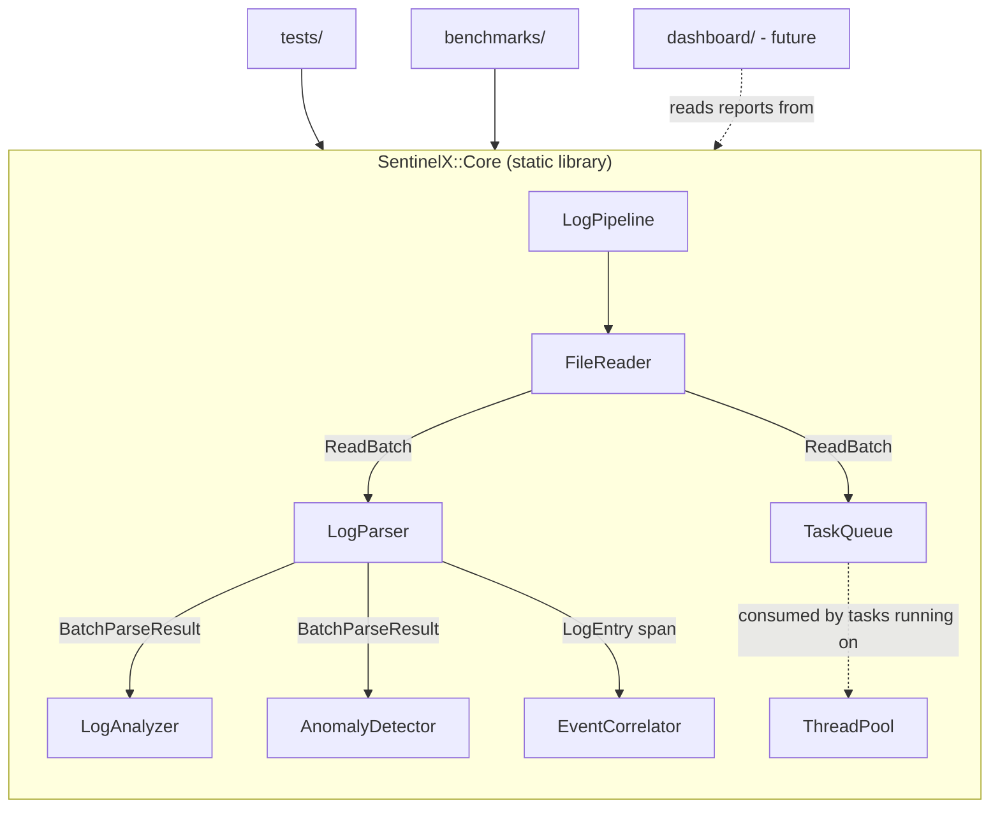
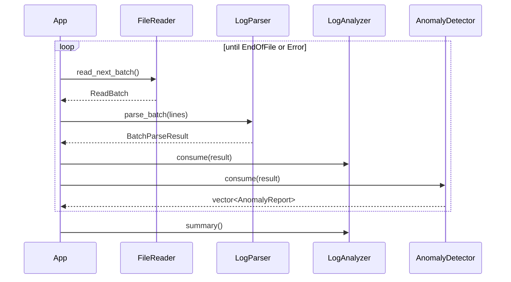
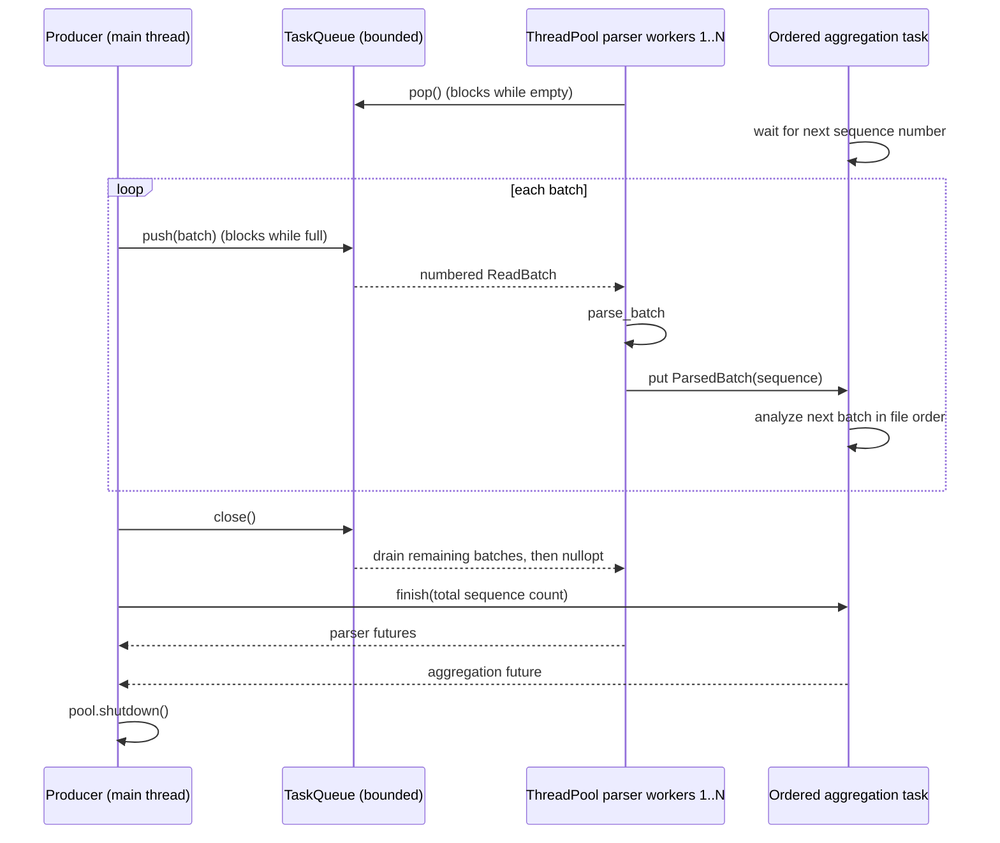

# SentinelX Architecture

This document describes how SentinelX is structured: module boundaries, data
flow, concurrency, shutdown, error handling, and design trade-offs. For build
and usage instructions, see the [README](../README.md).

## 1. Goals and Constraints

| Goal | How it is met |
| --- | --- |
| Process files larger than available memory | Streaming in fixed-size batches |
| Treat malformed input as data, not a crash | Status and error values; rejected lines are counted |
| Use multiple cores safely | Bounded queue, thread pool, and per-worker state |
| Produce explainable results | Reports include their inputs, thresholds, and reasoning |
| Keep the engine independent of any UI | The core library has no UI or dashboard dependency |
| Build reproducibly | CMake, with dependencies fetched at pinned commits |

Not yet in scope: network ingestion, persistent storage, a production daemon,
the dashboard, and machine-learning detection. The `sentinelx` CLI analyzes
local files and can generate a demo log.

## 2. Component View

Each module depends on very little else at compile time:

| Module | Depends on |
| --- | --- |
| FileReader | — |
| LogParser | — |
| LogAnalyzer, AnomalyDetector, EventCorrelator | LogParser types |
| TaskQueue | FileReader's `ReadBatch` |
| LogPipeline | FileReader, LogParser, LogAnalyzer, AnomalyDetector, TaskQueue, ThreadPool |
| ThreadPool | — (generic) |

There is no `TaskScheduler` module in this source tree; scheduling is handled
by `LogPipeline` using `ThreadPool` and `TaskQueue`.

## 3. Data Model

| Type | Produced by | Contents |
| --- | --- | --- |
| `ReadBatch` | FileReader | `status`, `lines`, `malformed_lines`, `error`; pipeline sequence and read-time metadata |
| `LogEntry` | LogParser | `sys_seconds` timestamp, `Severity`, `component`, `message` |
| `BatchParseResult` | LogParser | Valid `entries`, plus `issues` (each a line index and a `ParseError`) |
| `AnalysisSummary` | LogAnalyzer | Totals, severity distribution, errors per component, top and repeated errors |
| `AnomalyReport` | AnomalyDetector | Component, window start, observed count, mean, standard deviation, threshold, score, severity, explanation |
| `EventRecord` | Caller or EventCorrelator | Like `LogEntry`, but the timestamp is optional |
| `CorrelationResult` | EventCorrelator | Timelines, ranked reports, counts of missing and out-of-order timestamps |

These are all plain value types, so they can be safely moved between threads.

## 4. Processing Pipelines

### 4.1 Sequential

### 4.2 Concurrent (`sentinelx` CLI and `sentinelx_bench`)

Only parsing is parallel in `LogPipeline`. One ordered aggregation task owns
`LogAnalyzer` and `AnomalyDetector`; this avoids shared analyzer state and
preserves per-component timestamp order for anomaly detection. The benchmark
fingerprints and compares sequential and concurrent outputs for the same input
and batch size. The optional `SentinelXBenchmarks` target uses a separate
simplified loop and is not the benchmark documented in the README.

## 5. Module Internals

### FileReader
- Owns a `std::ifstream` in binary mode, using a caller-sized buffer installed
  with `pubsetbuf`.
- A batch size, buffer size, or maximum line length of zero produces an error
  status.
- Lines are built in a reused `std::string`. If a line is longer than
  `max_line_bytes` or contains NUL, the rest of it is discarded up to the next
  newline and it counts as malformed. CRLF line endings are normalized.
- Returns `Batch`, `EndOfFile`, or `Error`. Once an error occurs, every later
  call returns the same error.

### LogParser
- Stateless static functions.
- Slices fields with `std::string_view` and converts digit-only fields with
  `std::from_chars`; signs are rejected. It then checks the date with
  `year_month_day::ok()` and validates the time ranges.
- Allocates only for a valid entry (its `component` and `message` strings).
  `parse_batch` reserves space for the whole batch up front.
- Possible errors: `MissingTimestamp`, `InvalidTimestamp`, `MissingSeverity`,
  `UnsupportedSeverity`, `MissingComponent`, `MissingMessage`,
  `UnexpectedFormat`.

### LogAnalyzer
- Keeps one counter per severity in a fixed `std::array`, and uses
  `std::unordered_map`s for per-component and per-message error counts.
- `summary()` calculates percentages and sorts messages by count, breaking ties
  alphabetically, so output is deterministic.
- If a caller constructs a `Severity` value outside the enum, it is counted as
  malformed rather than used as an array index.
- Intended for a single owner: there is no internal locking.

### ThreadPool
- Holds a `std::queue<std::function<void()>>` guarded by one mutex and one
  condition variable.
- `submit()` wraps the callable in a `std::packaged_task` and returns its
  `future`. If the callable throws, the exception is counted and then rethrown
  through that future.
- Statistics (submitted, completed, failed, active) are `std::atomic` counters
  with relaxed ordering and are for diagnostics only.
- A `thread_local` pointer lets `shutdown()` detect when it is called from one of
  its own workers. In that case it throws `std::logic_error` instead of
  deadlocking on a self-join.
- The destructor calls `shutdown()`, so all threads are released automatically
  (RAII).

### TaskQueue
- Stores batches in a `std::deque`, each tagged with its enqueue time. The queue
  has a fixed capacity and two condition variables, `not_full_` and
  `not_empty_`.
- One mutex guards all state, including statistics, so `stats()` returns a
  consistent snapshot.

### AnomalyDetector
- For each component, tracks the current window index, the current ERROR count,
  and a `deque` of the last *N* completed window counts. Windows with no entries
  count as zero.
- An anomaly requires a full baseline, at least the configured minimum ERROR
  count, and `observed > mean + k·σ`, where σ is the population standard
  deviation. The comparison is strictly greater-than.
- The score is (observed − mean) / σ, which maps to the MEDIUM, HIGH, and
  CRITICAL bands. If σ = 0, there is no score and the severity is LOW.
- Detection runs at the end of each `consume()` call and whenever a window
  rolls over. A window is reported again only if its count has increased since
  the last report.
- Timestamps must not go backwards within a component; if they do,
  `std::invalid_argument` is thrown.

### EventCorrelator
- Groups events by component in an `unordered_map`, then sorts each group by
  timestamp with `stable_sort`. Events with no timestamp go last and are
  ignored by the time-based rules.
- An event counts as out of order if its timestamp is earlier than the latest
  one seen so far for that component.
- Three rules, each limited to `time_window`:
  - a WARNING followed by an ERROR,
  - the same ERROR message repeated,
  - the same pair of consecutive ERROR messages repeated.
- Relevance is `1 − distance / window`. It measures closeness in time, not
  probability. Reports are ranked by relevance, then component, then type.

## 6. Concurrency Model

| Shared state | Protected by | Wait condition |
| --- | --- | --- |
| ThreadPool task queue and `stopping_` | `queue_mutex_` + `condition_` | `stopping_ \|\| !tasks_.empty()` |
| TaskQueue items, `closed_`, statistics | `mutex_` + `not_full_` / `not_empty_` | `closed_ \|\| size < capacity` and `closed_ \|\| !empty` |
| ThreadPool counters | `std::atomic` | — |
| Analyzer and anomaly detector | Owned by one ordered aggregation task | — |
| Event correlator | Runs after pipeline aggregation in the CLI | — |

All waits re-check their condition, so spurious wakeups are harmless.

**Avoiding deadlocks**
- A thread holds at most one mutex at a time. The one exception is
  `ThreadPool::shutdown`, which always locks `shutdown_mutex_` before
  `queue_mutex_`.
- Condition variables are notified after the lock is released.
- Tasks never run while the pool's lock is held.

**No lost or duplicated work:** every item is either accepted (`push()` returns
`true`) or rejected because the queue is closed. Each accepted item is returned
by exactly one `pop()`. The TaskQueue stress test checks this with 2,000 batches
from 4 producers, each delivered exactly once.

## 7. Shutdown Sequence

1. When the producer has no more batches, it calls `TaskQueue::close()`.
2. Workers process the remaining batches; `pop()` then returns `nullopt`.
3. Worker tasks return, and the producer collects their futures.
4. `ThreadPool::shutdown()`, also called by the destructor, sets `stopping_`,
   wakes all workers, lets them finish any queued tasks, and joins every thread.

If the file read fails partway through, the producer closes the queue before
reporting the error, so no consumer is left blocked.

## 8. Error Handling

| Situation | Behavior |
| --- | --- |
| Missing or unreadable file; invalid reader options | `ReadStatus::Error` with a message |
| Empty file | `ReadStatus::EndOfFile` on the first call |
| Overlong line or NUL bytes | Line skipped and counted in `malformed_lines` |
| Malformed log line | `ParseIssue` with the line's index; counted by LogAnalyzer |
| Invalid detector or correlator options | Constructor throws `std::invalid_argument` |
| Task throws an exception | Rethrown by `future::get()`, and counted |
| `submit()` after shutdown | Throws `std::runtime_error` |
| `push()` after close | Returns `false` |

## 9. Build Architecture

- `SentinelXCore` is a static library whose public headers live under
  `include/`; `SentinelX::Core` is its alias.
- Test targets link `GTest::gtest_main`. If GoogleTest is not installed, version
  1.15.2 is fetched at a pinned commit. Test discovery has a 30-second timeout
  because test executables can start slowly on Windows.
- `sentinelx_bench` is built by default and benchmarks the real pipeline.
  `SENTINELX_BUILD_BENCHMARKS` additionally adds the legacy `SentinelXBenchmarks` target, using
  Google Benchmark 1.9.4 fetched at a pinned commit. On Windows it also links
  `Psapi` to read memory usage. The primary real-pipeline benchmark executable,
  `sentinelx_bench`, is a separate target built by default.
- Sanitizer flags apply to every target. On MSVC, `/fsanitize=address` is passed
  to the compiler only, and the linker selects the runtime. ThreadSanitizer is
  rejected under MSVC.

## 10. Known Limitations

- **No production daemon.** The `sentinelx` CLI analyzes a local file; there is
  no long-running service or dashboard yet.
- **Fixed log format.** Supporting other formats requires new parsers.
- **Reads one character at a time.** This is simple and bounds memory, but it
  is not the fastest approach. Profile before optimizing.
- **A single producer in the concurrent path.** File reading may limit
  throughput, but full benchmark data has not confirmed this.
- **Single-threaded anomaly detection.** It also requires timestamps in order
  within each component.
- **Correlation runs on a single set of events.** It does not carry state
  across calls the way a stream processor would.
- **Benchmark instrumentation has overhead.** Memory sampling and queue
  timestamps cost time, so use these metrics to compare runs, not as absolute
  measurements.
- **Memory is not strictly constant.** FileReader is bounded by batch and line
  settings, but aggregate maps and retained anomaly/correlation outputs grow
  with input cardinality and configured retention.
- **ThreadSanitizer and GDB were unavailable** in the validated MSVC
  environment; AddressSanitizer and concurrency stress tests do not replace TSan.

## 11. Extension Points

| Extension | Approach |
| --- | --- |
| New log format | Add a parser that returns `BatchParseResult`; downstream modules don't change |
| New detection rule | Add a detector that consumes `BatchParseResult` and returns its own report type |
| Dashboard | Serialize the report types (for example, to JSON) and serve them from a separate process |
| Parallel analysis | Keep state per worker and merge at the end, as the benchmark does |